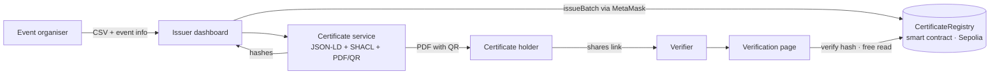

# CertiChain

**Verifiable blockchain certificates for university club events**

> SEN0401 Special Topics: Blockchain · Istanbul Kültür University · 2026–2027 Fall
> Status: 📝 **Proposal stage**: nothing is implemented yet.

---

## The problem

Student clubs at IKU give out workshop and event certificates as plain PDF files. Anyone with a PDF editor can change the name or date, and the fake looks exactly like the real one. When an employer or internship coordinator wants to check a certificate, the only option is to ask the club and wait. After the board graduates, the records are often gone.

Our customer, the **IKU Computer Club**, issues about **150–200 certificates per semester** (50–70 per event). Today, checking one certificate means searching Excel files and Google Drive by hand, which takes **1–2 days**.

## Our solution

CertiChain lets a club issue certificates that **anyone can verify in seconds**, without contacting the club or trusting a central server.

1. The **event organiser** uploads the attendance list (CSV) to a dashboard.
2. Each certificate is built as a JSON-LD document, and its **SHA-256 hash is recorded on Ethereum** (Sepolia testnet).
3. Each **certificate holder** gets a PDF with a QR code.
4. A **verifier** scans the QR code, or uploads the PDF, and sees **✅ Valid**, **⚠️ Revoked** or **❌ Not found**.

Only hashes go on chain. **No personal data is stored on the blockchain** (KVKK).

## Why blockchain?

A normal database run by the club could be edited, or disappear when the board changes. The on-chain record is **append-only, timestamped and publicly readable**, so a verifier doesn't have to trust the club or us. Revoking a certificate is public too.

## How it works



## Tech stack

| Layer | Technology |
|---|---|
| Smart contract | Solidity, OpenZeppelin AccessControl, Hardhat |
| Network | Ethereum Sepolia testnet (free) |
| Frontend | React, ethers.js, MetaMask |
| Backend | Node.js (certificate builder, PDF and QR generation) |
| Data format | JSON-LD (W3C Verifiable Credentials), PROV-O, SHACL validation |
| CI | GitHub Actions |

## Team

| Member | Responsibility | Role |
|---|---|---|
| Malak Alfakavi | Certificate registry smart contract | Team lead, smart-contract developer |
| Raghd Alfakavi | Issuer dashboard and verification page | Frontend, customer liaison |
| Ammar cashlan | Certificate generator and storage service | Backend developer |
| Mohamad Mahfouz Khalil | Credential schema, tests and CI | Test engineer, quality lead |

**Customer:** IKU Computer Club — contact: Asmaa, events organization coordinator ([interview notes](customer-interview.md))

## Roadmap

| Date | Milestone |
|---|---|
| 22 Oct 2026 | Proposal submitted, repository set up, customer interview done ✅ |
| 9 Nov 2026 | Smart contract with tests deployed on Sepolia |
| 23 Nov 2026 | Dashboard and certificate service issue a test batch end to end |
| 7 Dec 2026 | Verification page done; trial at the IKU Computer Club's December workshops |
| 16 Dec 2026 | Release v1.0 and test report |

## Repository structure (planned)

```
proposal/      Proposal Workbench files (JSON, Markdown, web page)
contracts/     Solidity smart contract + Hardhat tests
service/       Node.js certificate builder (JSON-LD, PDF, QR)
web/           React issuer dashboard and verification page
schema/        JSON-LD context and SHACL shape
docs/          Diagrams, meeting notes, test report
```

## Out of scope

- Mainnet deployment (costs real money)
- Personal data on chain
- Official university diplomas and transcripts
- Native mobile apps
