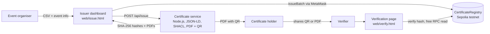

# CertiChain

**Verifiable blockchain certificates for university club events**

> SEN0401 Special Topics: Blockchain · Istanbul Kültür University · 2026–2027 Fall  
> Status: ✅ **Implemented & Verified** on Ethereum Sepolia Testnet

---

## Live Deployment (Ethereum Sepolia)

- **Smart Contract:** `CertificateRegistry.sol` (Solidity `v0.8.34`, OpenZeppelin `AccessControl`)
- **Contract Address:** [`0x7B40B303bD39685Ed6f7A236ff7E8F21D5D6B860`](https://sepolia.etherscan.io/address/0x7B40B303bD39685Ed6f7A236ff7E8F21D5D6B860#code)
- **Verification Status:** Verified Source Code & ABI on Sepolia Etherscan ✅
- **Compiler & Verification Settings:** Deployed & verified on Etherscan using Solidity `v0.8.34` (`optimizer: disabled`, EVM `default`), whereas `contracts/hardhat.config.js` targets `0.8.24` (`optimizer: enabled, runs: 200`) for local offline testing & coverage.
- **Public verify page:** https://malak600.github.io/Certificate-verification-check-certificates-with-a-QR-code/web/verify.html (GitHub Pages; every QR code opens this page with `?hash=0x...`)
- **Test Coverage:** 100% Line Coverage · 95.45% Branch Coverage (Hardhat)

---

## The Problem

Student clubs at IKU give out workshop and event certificates as plain PDF files. Anyone with a PDF editor can change the name or date, and the fake looks exactly like the real one. When an employer or internship coordinator wants to check a certificate, the only option is to ask the club and wait. After the board graduates, the records are often gone.

Our customer, the **IKU Computer Club**, issues about **150–200 certificates per semester** (50–70 per event). Today, checking one certificate means searching Excel files and Google Drive by hand, which takes **1–2 days**.

---

## Our Solution

CertiChain lets a club issue certificates that **anyone can verify in seconds**, without contacting the club or trusting a central server:

1. The **event organiser** uploads the attendance list (CSV) and event metadata via the Issuer Dashboard (`issue.html`).
2. The backend service builds each certificate as a **W3C JSON-LD** credential, validates it against a **SHACL** shape, computes its canonical **SHA-256 hash** (see [HASHING.md](HASHING.md)), and embeds a verification **QR code** into a downloadable PDF.
3. The organiser anchors the batch of SHA-256 hashes onto **Ethereum Sepolia** via **MetaMask** (`issueBatch`).
4. A **verifier** scans the QR code, pastes the hash or uploads the certificate PDF on the Verification Page (`verify.html`) and immediately sees **✅ Valid**, **⚠️ Revoked**, or **❌ Not found**.

Only cryptographic hashes go on chain. **No personal data is stored on the blockchain** (KVKK compliant).

---

## Architecture & Workflow




---

## Why Blockchain?

A normal database run by the club could be edited, or disappear when the board changes. The on-chain record is **append-only, timestamped and publicly readable**, so a verifier doesn't have to trust the club or us. Revoking a certificate is public too.

---

## Quick Start

**Verify a certificate:** open the [public verify page](https://malak600.github.io/Certificate-verification-check-certificates-with-a-QR-code/web/verify.html), then scan the QR code, paste the hash, or upload the certificate PDF.

**Issue certificates (organiser):**

```bash
cd service
npm install
npm start            # API on http://localhost:3001
```

Then open `web/issue.html` (e.g. with VS Code Live Server), connect MetaMask on **Sepolia** with a wallet that has the issuer role, upload the attendance CSV (`name,email`), fill in the event details and press **Issue**. The page sends the CSV to the service, records the hashes with `issueBatch`, and lets you download the PDFs as a ZIP.

**Run the tests:**

```bash
# from the repository root
(cd service && npm install && npm test)               # service tests
(cd contracts && npm install && npm test)             # contract tests (Hardhat)
pip install pyshacl                                   # SHACL check (objective O4)
node schema/tools/generate-samples.mjs schema-samples
python schema/tools/validate.py schema-samples
```

---

## Tech Stack

| Layer | Technology |
|---|---|
| Smart contract | Solidity, OpenZeppelin AccessControl, Hardhat |
| Network | Ethereum Sepolia testnet (free) |
| Frontend | HTML + JavaScript, ethers.js v6, MetaMask, GitHub Pages |
| Backend | Node.js HTTP API (certificate builder, PDF and QR generation) |
| Data format | JSON-LD (W3C Verifiable Credentials v2), PROV-O, SHACL (pySHACL in CI) |
| CI | GitHub Actions (service tests, SHACL conformance, contract tests + coverage) |

---

## Team

| Member | Responsibility | Role |
|---|---|---|
| Malak Alfakavi | Certificate registry smart contract | Team lead, smart-contract developer |
| Raghd Alfakavi | Issuer dashboard and verification page | Frontend, customer liaison |
| Mohammed Ammar | Certificate generator and storage service | Backend developer |
| Mohamad Mahfouz Khalil | Credential schema, tests and CI | Test engineer, quality lead |
| Ujala Ali Qureshi | User guide and December trial (joined Nov 2026) | Documentation |

**Customer:** IKU Computer Club — contact: Asmaa, events organization coordinator ([interview notes](customer-interview.md))

---

## Roadmap

| Date | Milestone |
|---|---|
| 22 Oct 2026 | Proposal submitted, repository set up, customer interview done ✅ |
| 9 Nov 2026 | Smart contract with tests deployed on Sepolia ✅ (deployed 30 Oct) |
| 23 Nov 2026 | Dashboard and certificate service issue a test batch end to end ⏳ |
| 7 Dec 2026 | Verification page done; trial at the IKU Computer Club's December workshops |
| 16 Dec 2026 | Release v1.0 and test report |

---

## Repository Structure

```
contracts/     Solidity smart contract + Hardhat tests
service/       Node.js certificate service: HTTP API, JSON-LD builder, PDF + QR
web/           Issuer dashboard (issue.html) and verification page (verify.html)
schema/        JSON-LD context, SHACL shape and the pySHACL check
.github/       CI workflow
HASHING.md     How a certificate hash is computed
Verification & Test Report.md   Milestone 2 test report
Dashboard & Service Batch End-to-End Verification Report.md   Batch issuance end-to-end report
customer-interview.md           Interview with the IKU Computer Club
```

---

## Out of Scope

- Mainnet deployment (costs real money)
- Personal data on chain
- Official university diplomas and transcripts
- Native mobile apps
