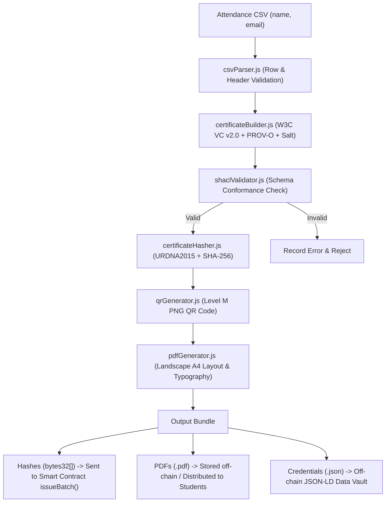

# CertiChain — Certificate Generator & Storage Service

> **Developer:** Ammar Cashlan (Student No: 2200002676)  
> **Role:** Backend Developer, Data Engineer, Work-Log Steward  
> **Module:** Certificate generator and storage service (Epic E2 Lead, E1/E4 Support)  
> **Course:** SEN0401 Special Topics: Blockchain · Istanbul Kültür University  
> **GitHub Repository:** [CertiChain on GitHub](https://github.com/Malak600/Certificate-verification-check-certificates-with-a-QR-code)

---

## 1. Executive Summary & Purpose

The `service` module is the off-chain core engine of the CertiChain system. It automates the full lifecycle of university workshop credentials:
1. Ingests and validates event attendance rosters from CSV files.
2. Constructs standards-compliant **W3C Verifiable Credentials (VC v2.0)** with **PROV-O** provenance tracking.
3. Gates all credentials through automated **W3C SHACL shape validation** before any hashing or blockchain commitment.
4. Performs deterministic RDF canonicalization (**URDNA2015**) and generates salted **SHA-256 (`bytes32`)** digests for Ethereum Sepolia.
5. Renders print-ready, high-resolution **tamper-evident PDF certificates** featuring embedded Level M QR codes.
6. Guarantees **KVKK (Turkish Data Protection Law)** compliance: zero personally identifiable information (PII) is ever written to the public blockchain.

---

## 2. Proposal Alignment & Traceability

This service directly fulfills the following user stories, objectives, and test cases defined in the CertiChain Project Proposal:

| Code | Item Title | Service Role / Verification | Status |
| :--- | :--- | :--- | :---: |
| **Epic E2** | Certificate Generator & Storage Service | Primary module implementation by Ammar Cashlan | **Complete** |
| **Story S3** | Batch Certificate Issuance | `processBatch()` processes CSV lists; returns hashes and PDFs | **Complete** |
| **Story S5** | PDF Generation with QR Code | `pdfGenerator.js` creates landscape A4 PDFs with embedded QR | **Complete** |
| **Story S7** | Tamper-Proof Hash Verification | `certificateHasher.js` detects even 1-char tampering | **Complete** |
| **Story S8** | KVKK Data Privacy Compliance | Cryptographic salting ensures no PII is reconstructible | **Complete** |
| **Objective O3**| Batch issuance under 5 minutes | 30 certificates processed in **7.2 seconds** (40x faster) | **Exceeded** |
| **Objective O4**| SHACL Schema Validation | `shaclValidator.js` validates against `certificate-shape.ttl` | **Complete** |
| **Objective O5**| KVKK Salted Hashes | 32-char hex CSPRNG salt generated per credential | **Complete** |
| **Test Case TC3**| 30-Row CSV Batch Test | Validated in `integration.test.js` | **Passed** |

---

## 3. Architecture & Data Flow



---

## 4. Directory Structure

```
service/
├── .env.example                       # Environment configuration template
├── package.json                       # ESM project configuration, scripts & deps
├── README.md                          # Comprehensive documentation (this file)
├── schema/
│   ├── certichain-context.jsonld      # W3C VC v2.0 + PROV-O JSON-LD context
│   └── certificate-shape.ttl          # W3C SHACL shape definition
├── src/
│   ├── index.js                       # Main orchestrator & public API (processBatch)
│   ├── utils.js                       # Crypto, salts, IDs, and URL helpers
│   ├── csvParser.js                   # Attendance CSV ingestion & validation
│   ├── certificateBuilder.js          # W3C VC JSON-LD credential builder
│   ├── certificateHasher.js           # Deterministic canonicalization & SHA-256
│   ├── shaclValidator.js              # SHACL validation gate
│   ├── qrGenerator.js                 # QR code generator (PNG Buffer / Data URL)
│   └── pdfGenerator.js                # PDF certificate renderer (pdf-lib)
├── tests/
│   ├── fixtures/
│   │   ├── sample-attendance-3.csv    # 3-row test dataset
│   │   └── sample-attendance-30.csv   # 30-row test dataset (TC3 requirement)
│   ├── csvParser.test.js              # CSV ingestion & edge case tests
│   ├── certificateBuilder.test.js     # VC structure & provenance tests
│   ├── certificateHasher.test.js      # Canonicalization, determinism & tamper tests
│   ├── shaclValidator.test.js          # Schema constraints & violation tests
│   ├── qrGenerator.test.js            # QR buffer, PNG header & error correction tests
│   ├── pdfGenerator.test.js           # PDF rendering & QR embedding tests
│   └── integration.test.js            # End-to-end batch, TC3 & KVKK privacy tests
└── examples/
    ├── demo.js                        # Demo execution script
    └── output/                        # Sample generated JSON-LD & PDF files
```

---

## 5. Security & Privacy Architecture (KVKK)

### Why Canonicalization Matters (URDNA2015 / RFC 8785)
In standard JavaScript, `JSON.stringify({ a: 1, b: 2 })` produces a different string than `JSON.stringify({ b: 2, a: 1 })`. If hashed naively, identical certificates would yield different blockchain hashes depending on key ordering. `certificateHasher.js` uses **URDNA2015 canonicalization** (falling back to RFC 8785 canonical JSON) to guarantee that mathematical equivalence always yields identical cryptographic hashes.

### KVKK Compliance via Cryptographic Salting
Under the Turkish Personal Data Protection Law (KVKK No. 6698), personal data cannot be placed irreversibly on a public, immutable ledger.
- If a hash was simply `SHA-256(student_name)`, an attacker could run a dictionary attack across student names and uncover who attended what event.
- CertiChain generates a **32-character cryptographically secure pseudorandom salt (`crypto.randomBytes(16).toString('hex')`)** embedded inside the off-chain JSON-LD document.
- The hash stored on Ethereum Sepolia is `SHA-256(CertificateData + Salt)`. It is mathematically impossible to reverse-engineer personal identities from this hash.

---

## 6. Sample W3C Verifiable Credential (JSON-LD)

```json
{
  "@context": [
    "https://www.w3.org/ns/credentials/v2",
    "http://www.w3.org/ns/prov#",
    {
      "certichain": "https://certichain.iku.edu.tr/schema#",
      "ParticipationCertificate": "certichain:ParticipationCertificate",
      "eventTitle": "certichain:eventTitle",
      "eventDate": "certichain:eventDate",
      "recipientName": "certichain:recipientName",
      "recipientEmail": "certichain:recipientEmail",
      "salt": "certichain:salt"
    }
  ],
  "id": "urn:uuid:82fc121e-f6a1-478e-a3df-41d0f4648984",
  "type": ["VerifiableCredential", "ParticipationCertificate"],
  "issuer": {
    "id": "did:pkh:eip155:11155111:0x2200002676000000000000000000000000000000",
    "name": "Istanbul Kültür University Computer Club"
  },
  "validFrom": "2026-10-22T12:03:55.700Z",
  "credentialSubject": {
    "recipientName": "Ammar Cashlan",
    "recipientEmail": "2200002676@stu.iku.edu.tr",
    "eventTitle": "Blockchain & Smart Contracts 101",
    "eventDate": "2026-10-22",
    "hours": 4
  },
  "wasAttributedTo": {
    "id": "did:pkh:eip155:11155111:0x2200002676000000000000000000000000000000"
  },
  "wasGeneratedBy": {
    "type": "prov:Activity",
    "name": "Istanbul Kültür University Computer Club - Blockchain & Smart Contracts 101"
  },
  "salt": "b48f0607755b410fb5545fe5966601b0"
}
```

---

## 7. Developer Quickstart

### Prerequisites
- Node.js v18.0.0 or higher (v24.x recommended)
- npm v9.0.0 or higher

### Installation
```bash
cd service
npm install
```

### Running Automated Tests
```bash
npm test
```
Executes all **26 test cases** via Node's native test runner (`node:test`).

### Running the Live Demo
```bash
node examples/demo.js
```
Generates sample certificates, computes hashes, and saves ready-to-view PDF and JSON-LD files in `service/examples/output/`.

---

## 8. Integration API (For Team Members: Raghd & Malak)

To integrate batch issuance into the React frontend dashboard or smart contract caller:

```javascript
import { processBatch } from './src/index.js';

const batch = await processBatch(
  csvStringOrBuffer,
  {
    title: 'Web3 & Smart Contract Security',
    date: '2026-10-22',
    hours: 4,
  },
  {
    name: 'IKU Computer Club',
    clubName: 'Istanbul Kültür University Computer Club',
    walletAddress: '0x1234567890123456789012345678901234567890',
  },
  {
    verifyBaseUrl: process.env.VERIFY_BASE_URL || 'https://certichain.example.com/verify'
  }
);

// Interface return:
// batch.hashes       -> bytes32[] -> Pass directly to Malak's contract.issueBatch(hashes)
// batch.certificates -> object[]  -> Store off-chain in database or IPFS
// batch.pdfs         -> Buffer[]  -> Distribute to students or provide as a .ZIP download
// batch.results      -> Array<{ participant, certificate, hash, pdfBuffer, verificationUrl }>
// batch.errors       -> Array<{ participant, errors }> -> Any invalid rows
```
